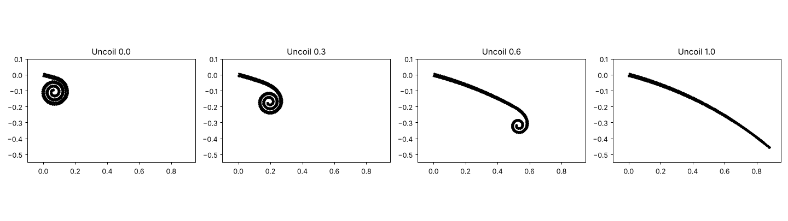
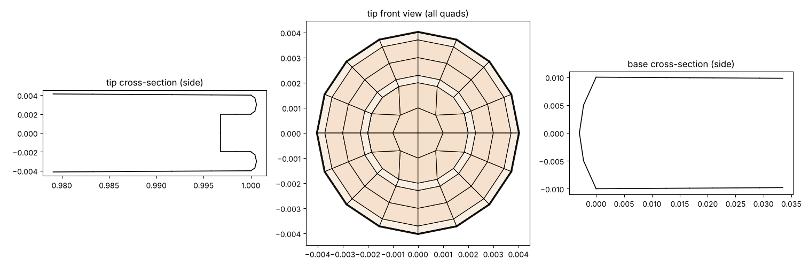

# Butterfly Proboscis（蝶の口吻）Blender アドオン

くるくる巻いた蝶の口吻を Geometry Nodes で作るアドオンです。
**Uncoil** の値をキーフレームすると、水や蜜を飲むときに根元からほどけて伸びるアニメーションが作れます。

## インストール

1. `butterfly_proboscis.zip` をダウンロード
2. Blender → `Edit > Preferences > Add-ons` → 右上の ▼ → **Install from Disk...** で zip を選択
3. 「Butterfly Proboscis」を有効化

対応: Blender 4.0 以降（Blender 5.2 で動作確認済み）

## 使い方

- **追加**: 3D ビューで `Shift+A > Mesh > Butterfly Proboscis`
  （または サイドバー `N` > **Butterfly** タブ > Add Proboscis）
  - 頭のオブジェクトを選択した状態で追加すると、その子として 3D カーソル位置に作られます
  - 口吻は +Y 方向（前）に伸び、下側に巻きます。頭に合わせて回転・移動してください
- **調整**: サイドバーの Butterfly タブ、またはモディファイアパネルで値を変更

| パラメータ | 内容 |
|---|---|
| **Uncoil** | 0 = 巻いている / 1 = 伸びている（アニメーション用） |
| Wiggle Amount / Frequency / Phase | 伸びた部分の「探る」ような揺れ。Phase を動かすと波が流れる |
| Length | 全長（巻いても伸ばしても長さは一定） |
| Turns | 巻き数 |
| Inner Radius | 螺旋の中心（先端）の半径 |
| Straight Base | 根元のまっすぐな部分の割合 |
| Base Angle | 根元の向き（正で下向き） |
| Extended Bend | 伸ばしたときの反り |
| Uncoil Softness | ほどける境目のなめらかさ |
| Base Radius / Tip Radius | 根元・先端の太さ |
| Tip Hole Radius | 先端の穴の半径（先端の太さに対する割合） |
| Tip Hole Depth | 先端の穴の深さ（先端の太さに対する倍率） |
| Tip Lip | 穴のふちの盛り上がり |
| Profile Resolution | 断面の分割数（4 の倍数に丸められます） |

> 巻きが重なる場合は Turns を減らすか Base Radius を細くしてください
> （巻きの隙間 ≒ (Length×(1−Straight Base)/(π×Turns) − 2×Inner Radius) / Turns）。

## メッシュ構造

- **すべて四角ポリゴン**（三角形・N-gon なし）、穴のない閉じたメッシュ、法線は外向き
- 先端: ふちが内側に丸まった **くぼみ（穴）**。底面も四角ポリゴンのグリッドで埋めています
- 根元: 四角ポリゴンのゆるいドームで閉じています
- そのまま Subdivision Surface をかけてもきれいに丸まります

## Edit モードで編集する（UV 展開など）

Geometry Nodes で作った形はそのままでは Edit モードで編集できないので、
サイドバー Butterfly タブの **Edit Mode** 欄から次のどちらかを選びます。

### Make Editable (Keep Animation) — アニメーションを残したまま編集
- 今の形を実体のメッシュにして、**Uncoil などのアニメーションはそのまま動きます**
- 自動でシーム（根元・先端の境目＋縦に 1 本）を入れて UV 展開します（オフにもできます）
- Edit モードで編集して保持されるもの: **UV・シーム・マテリアル割り当て・頂点グループ・選択・頂点カラー** など
- 頂点の **位置** は口吻の形で上書きされます（形は Shape のパラメータで調整してください）
- 頂点の追加・削除をしたり、Resolution / Profile Resolution を変えると、頂点数が合わなくなり形が動かなくなります（パネルに警告が出ます）。
  元に戻すか **Rebuild Mesh** で作り直してください（UV はリセットされます）
- Edit モードで表示される編集用のワイヤーは、Make Editable したときの形です。
  見やすい形（例: Uncoil = 1）で実行するのがおすすめです

### Apply as Mesh (Freeze) — 普通のメッシュに確定
- モディファイアを外して普通のメッシュにします。自由にモデリングできますが、アニメーションは無くなります

## アニメーション（水を飲む）

### 自動
口吻を選択 → サイドバー Butterfly タブ → **Add Drinking Animation**。
現在フレームから「伸ばす → 飲む（先端を揺らして探る）→ 巻き戻す」のキーが打たれます。
実行後に左下のパネルでフレーム数や揺れの強さを変更できます。

### 手動
サイドバーまたはモディファイアパネルの **Uncoil** の上で `I` キー → キーフレーム。
例: 1F で 0、20F で 1、80F で 1、110F で 0。

## しくみ

口吻を点列として、各点の曲率を決めて積分（Accumulate Field）して形を作っています。

- 巻いた状態: 長さ一定のアルキメデス螺旋になる曲率 `k = 1 / sqrt(r0² − (g/π)·l)`
- 伸びた状態: ゆるい一定の曲率 + 先端ほど大きい正弦波の揺れ
- Uncoil に応じて、根元側から順に「巻き」→「伸び」の曲率へ切り替え

本物の蝶と同じく、全長を保ったまま根元からほどけていきます。
