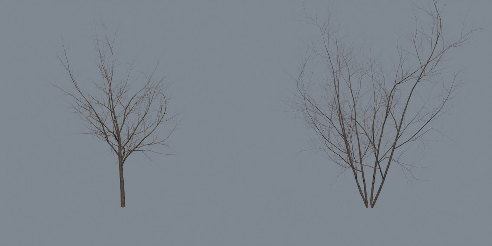

# いばらジェネレーター (Blender アドオン)



`thorn_bush.py` は、細かく枝分かれした実在のいばら (サンザシ・リンボク・カラタチのような
トゲのある落葉低木〜小高木) を **1 株ずつ** 生成する Blender アドオンです。
株は 3D カーソルの位置に、根元を原点にした 1 つのメッシュオブジェクトとして置かれるので、
コピーして好きな場所に配置できます。地面・霧・ライトは作りません。
1 ファイルで完結しており、外部依存はありません (Blender 4.2 以降、5.3 で動作確認)。

## 使い方

### インストール (Blender 4.2 以降)

`thorn_bush-4.0.0.zip` を Blender のウィンドウにドラッグ&ドロップし、確認ダイアログで「OK」。

以前の「茨の森」「ススキの草原」を入れている場合は、編集 > プリファレンス > アドオン から
アンインストールしてください (別のアドオンとして共存はします)。

### 株を作る

1. 置きたい場所に 3D カーソルを置く (Shift + 右クリック)
2. 3D ビューで `N` キー → サイドバーの「いばら」タブで **いばらを1株生成**
   (追加 > メッシュ > いばら からも作れます)
3. 「毎回ちがう形」がオンなら押すたびに別の形になります。使ったシードはパネルの「シード」欄と、
   オブジェクトのカスタムプロパティ `thorn_seed` に残ります。同じ形を作り直したいときは
   「毎回ちがう形」をオフにしてそのシードを入れます
4. 生成直後は左下の「いばらを1株生成」パネルを開いて、値を変えてその場で作り直せます

### 配置するときのコツ

- **Alt + D (リンク複製)** で複製すると、メッシュを共有するのでいくつ並べても軽いままです。
  回転 (R Z) と拡大縮小 (S) を変えるだけで同じ株でも別の株に見えます
- 形のちがう株を何種類か作っておき、それをリンク複製して並べるのがおすすめです
- マテリアル `Thorn_Bark` (幹・太い枝)、`Thorn_Twig` (小枝・短枝)、`Thorn_Spine` (トゲ) は
  全株で共有されるので、1 つ編集すると全部に反映されます

### ヘッドレス (コマンドライン)

```sh
blender -b -P thorn_bush.py -- --seed 7 --height 3 --form SHRUB --save bush.blend
blender -b -P thorn_bush.py -- --seed 7 --render bush.png   # 確認用の簡単な光とカメラでレンダリング
blender -b -P thorn_bush.py -- --help
```

zip は `python3 build_zip.py` で `thorn_bush.py` と `blender_manifest.toml` から作り直せます。

## 枝の生成のしくみ

- **高木型** (1 本の幹の上に樹冠) か **株立ち型** (根元から何本もの幹) を選べる (ランダムも可)
- 枝は **節** ごとに伸びる。節間はほぼまっすぐで、節で向きが小さく折れるため、直線的で硬い枝ぶりになる
- 側枝は 1 つの節から 1 本ずつ互生 (黄金角) で出て、先端は延長枝としてさらに伸びる。これを再帰的に繰り返す
- 子の枝は分岐点での親の太さに比例して細くなり、根元側の側枝ほど長い。小枝の先は鋭くとがる
- 節からは先がトゲ状にとがった **短枝** が出て、節にはトゲが付く (幹には付かない)
- 一部の枝は途中で折れて止まった **枯れ枝** になる

## 主なパラメータ

- **形**: 高さ・樹形・株立ちの幹数・幹の太さ
- **枝**: 枝の階層・枝の数・分岐角・枝の長さ比・枝の太さ比・上向き・節の間隔・節の折れ・うねり・枝垂れ
- **リアルさ**: 短枝の多さ・枯れ枝の割合
- **トゲ**: 節ごとに付く確率・長さ・反り
- **軽さ**: 幹の断面の角数・小枝の断面の角数 (細い枝ほど自動で角数が減る)

## 重さの目安

枝はカーブではなく直接メッシュとして作り、太さに応じて断面の角数を減らしています
(小枝は三角形の断面、トゲは三角錐)。デフォルト (高さ 2.5 m) で 1 株あたり
高木型 約 2〜3 万頂点、株立ち型 約 6〜8 万頂点、生成は 0.3 秒以下です。
もっと軽くしたいときは「枝の階層」「枝の数」「短枝の多さ」「トゲの付く割合」を下げるか、
「節の間隔」を大きくしてください。
