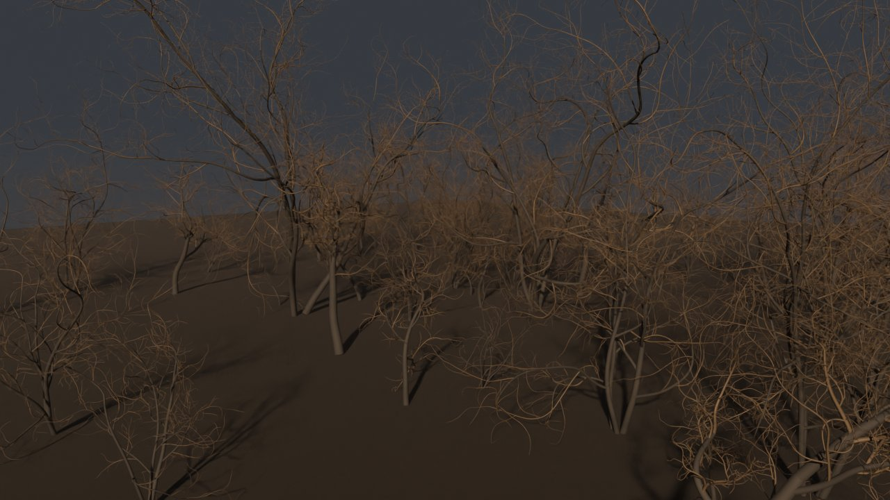
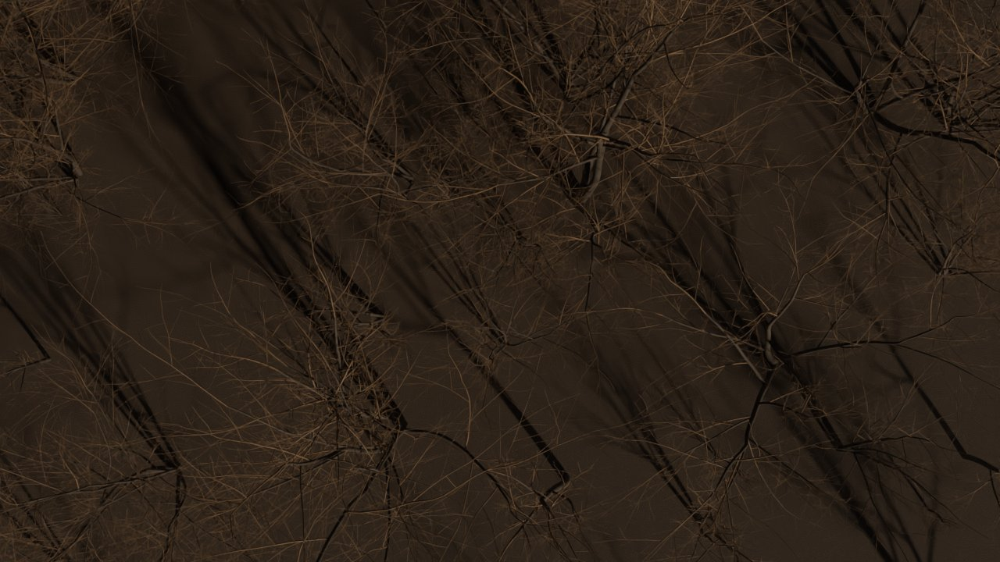

# 茨の森ジェネレーター (Blender アドオン)




`thorn_forest.py` は、細かく枝分かれした実在のいばら (サンザシ・リンボク・カラタチのような
トゲのある落葉低木〜小高木) の群落を Blender 上で手続き生成するアドオンです。
株ごとの大きさにばらつきを付けて、変化のある茂みを作れます。
1 ファイルで完結しており、外部依存はありません (Blender 3.6 以降 / 5.2 で動作確認)。

生成されるもの:

| オブジェクト | 内容 |
| --- | --- |
| `TF_Branches` | 幹と太い枝 (カーブ)。暗い樹皮のマテリアル |
| `TF_Twigs` | 細い小枝・短枝・落ち枝の小枝 (カーブ)。明るい褐色のマテリアル。数が多いので断面を粗くして軽くしている |
| `TF_Thorns` | 枝の節に付く細いトゲ (幹には付かない) |
| `TF_Ground` / `TF_Fog` / `TF_Sun` | 地面・地表の霞・低い角度の日差し (「空と光」オプション、空は物理ベースの Sky テクスチャ) |

すべて `Thorn Forest` コレクションに入り、再生成時は前回分が置き換わります。
同じシードなら毎回同じ森になります。

## 枝の生成のしくみ

- 各株は **高木型** (1 本の幹の上に樹冠) か **株立ち型** (根元から何本もの幹) のどちらか
- 枝は **節** ごとに伸びる。節間はほぼまっすぐ (わずかに弓なり) で、節で向きが小さく折れるため、木本らしい直線的で硬い枝ぶりになる
- 側枝は 1 つの節から 1 本ずつ互生 (黄金角) で出て、先端は延長枝としてさらに伸びる。これを再帰的に繰り返す
- 子の枝は分岐点での親の太さに比例して細くなり、根元側の側枝ほど長い。小枝の先は鋭くとがる
- 節からは先がトゲ状にとがった **短枝** が出て、節にはトゲが付く (幹には付かない)
- 一部の枝は途中で折れて止まった **枯れ枝** になり、地面には **落ち枝** が散らばる
- 小さい株は枝分かれが自動で浅くなる (若い株らしく枝がまばらになる)

## 使い方

### ドラッグ&ドロップでインストール (Blender 4.2 以降)

1. `thorn_forest-3.0.0.zip` を Blender のウィンドウにドラッグ&ドロップし、確認ダイアログで「OK」
2. 3D ビューで `N` キー → サイドバーの「茨の森」タブ
3. パラメータを調整して **茨の森を生成**。**シードを変えて再生成** で別のバリエーション

(編集 > プリファレンス > アドオン > 右上の ▼ > ディスクからインストール で zip を選んでも同じです。
Blender 3.6〜4.1 では zip ではなく `thorn_forest.py` を同じメニューから選んでください。)

zip は `python3 build_zip.py` で `thorn_forest.py` と `blender_manifest.toml` から作り直せます。

### スクリプトとして

テキストエディタで `thorn_forest.py` を開いて「スクリプト実行」するとパネルが登録されます。

### ヘッドレス (コマンドライン)

```sh
# 生成して .blend に保存
blender -b -P thorn_forest.py -- --seed 7 --plant-count 60 --save forest.blend

# カメラを置いて Cycles でレンダリング (--view aerial で真上から)
blender -b -P thorn_forest.py -- --seed 3 --render forest.png --samples 64 --view aerial

# 全オプション
blender -b -P thorn_forest.py -- --help
```

Python コンソールからは `build_forest(seed=3, plant_count=60)` のように呼べます
(パネルの各項目名がそのまま引数名です)。

## 主なパラメータ

- **全体**: 範囲・株の数・間隔 (0 で樹冠が自由に重なる)
- **大きさのばらつき**: 最小の高さ・最大の高さ・小さい株の多さ (1 で大小が均等、大きくすると小さい株が多く大きい株がまれになる)。最小と最大を同じにすれば大きさがそろう
- **樹形**: 高木型の割合・株立ちの幹数・幹の太さ (株の大きさに応じて自動で変わる)
- **枝**: 枝の階層・枝の数・分岐角・枝の長さ比・枝の太さ比・上向き・節の間隔・節の折れ・うねり (枝全体のゆるい曲がり)・枝垂れ
- **リアルさ**: 短枝の多さ・枯れ枝の割合・落ち枝の数
- **トゲ**: 節ごとに付く確率・長さ・反り (0 でまっすぐ、プラスで根元側へ鉤状)
- **シーン**: 地面 (落ち葉まじりの土)・空と光 (物理ベースの空・低い日差し・霞)・メッシュ変換 (FBX/OBJ 等への書き出し用)

## 重さの目安

デフォルト設定で小枝 約 5.7 万本、トゲ 約 65 万頂点 (生成 約 7 秒)。重い場合は
「枝の階層」「枝の数」「株の数」「トゲの付く割合」を小さくするか、「節の間隔」を大きくしてください。
カーブのままにしておくと、生成後でもカーブのプロパティ (ベベルの解像度など) で軽さを調整できます。
