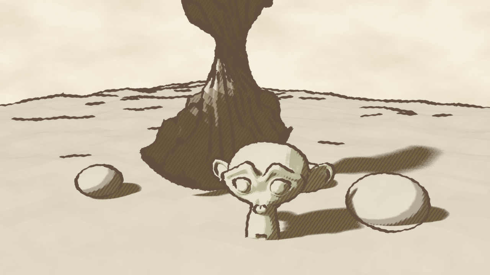

# Arthur Rackham 風 Ink & Wash シェーダー (Blender)

`rackham_shader.py` は、アーサー・ラッカムの挿絵みたいな
「褪せたセピアの水彩ウォッシュ + ペンの輪郭線とハッチング + 黄ばんだ紙」
のルックを Blender で作るスクリプトです。

対応: Blender 4.2 以降 / 5.x（EEVEE）。`Shader to RGB` を使うので **Cycles では動きません**。



（デモシーンを EEVEE で 1280×720 レンダリングした例）

## 使い方

### GUI
1. Scripting タブで `rackham_shader.py` を開いて **Run Script**
2. 動作
   - メッシュを選択している → そのマテリアルの Base Color を引き継ぎ、Rackham マテリアルに置き換える
   - 何も選択していない → デモシーン（ねじれた古木・ゴブリン・岩）を作成
3. レンダー設定（EEVEE、ビュー変換 Standard、ワールドに紙、Freestyle）は自動で設定されます

### コマンドライン
```
blender -b -P rackham_shader.py -- --demo --render //rackham.png
blender -b myscene.blend -P rackham_shader.py -- --render //out.png   # シーン内の全メッシュに適用
```

## しくみ

| 要素 | 実装 |
|---|---|
| 3段階の水彩トーン | Diffuse → Shader to RGB で光量を取り、smoothstep で「紙 / 中間ウォッシュ / 影」に分ける |
| 褪せた顔料 | Base Color を彩度を落とし、影色(アンバー)に寄せてから紙色に乗算 |
| ウォッシュのムラ | オブジェクト座標のノイズで光量を揺らし、帯の境界をにじませる |
| 顔料の粒状感・縁の溜まり | 高周波ノイズと Layer Weight(Facing) で影色を重ねる |
| ハッチング | スクリーン座標の Wave テクスチャを2方向に。暗さのしきい値ごとに1本目→クロスハッチが現れる。Distortion で手の揺れ |
| 紙 | スクリーン座標の2種類のノイズでグレイン、ワールドは黄ばみムラのある紙色 |
| 輪郭線 | Freestyle。Perlin ノイズ+サイン変位で揺れ、Backbone Stretcher で線のはみ出し、入り抜き＋カリグラフィ＋ノイズで筆圧 |

## 主なパラメータ（グループノード `Rackham Ink & Wash`）

- **Base Color** – 固有色。彩度高めで入れても自動で褪色します
- **Paper Color / Ink Color / Shadow Tint** – 紙・インク・影の色
- **Desaturate** – 褪色の強さ（ラッカムらしさの肝。0.5〜0.7 推奨）
- **Light / Shadow Threshold** – 紙が見える明部 / 影の境界
- **Highlight Wash** – 明部にどれだけ薄く色を残すか
- **Hatch Threshold / Cross Hatch Threshold** – ハッチが入り始める暗さ
- **Hatch Density / Width / Wobble / Strength** – ハッチの密度・太さ・揺れ・濃さ
- **Wash Variation / Wash Scale** – 水彩ムラの強さ・大きさ
- **Paper Grain** – 紙のザラつき
- **Aspect** – レンダー解像度の縦横比（スクリプト実行時に自動設定。解像度を変えたら再実行かここを修正）

輪郭線の太さや揺れは Freestyle の Line Style `Rackham Pen` で調整します
（View Layer プロパティ → Freestyle Line Style）。

## コツ

- ライトは Sun 1灯が基本。影がはっきりするほどハッチングが映えます
- 木の幹・根・岩など凹凸の多いモデルほど Freestyle の線が効いてラッカムっぽくなります
- 画面全体の色は「セピア・オリーブ・くすんだ青灰」の範囲に抑えると雰囲気が出ます
