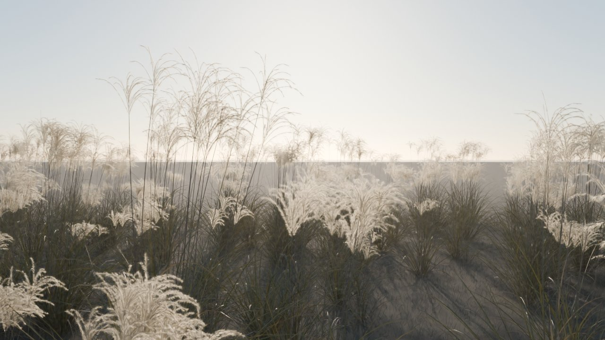
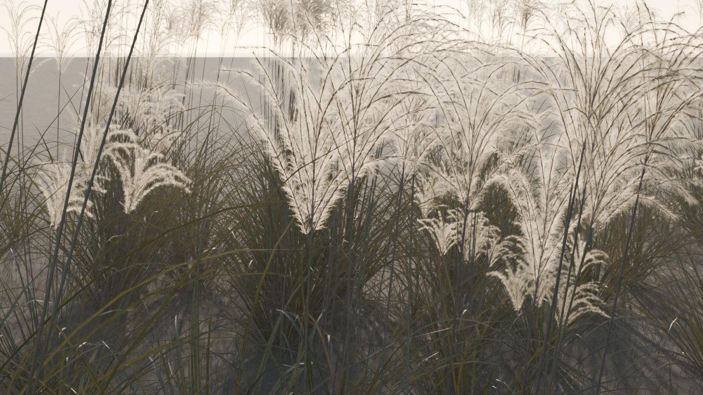

# ススキの草原ジェネレーター (Blender アドオン)




`susuki_field.py` は、ススキ (Miscanthus sinensis) の草原を Blender 上で手続き生成するアドオンです。
株ごとの大きさにばらつきを付けて並べ、風向き・風の強さで全体をなびかせます。
1 ファイルで完結しており、外部依存はありません (Blender 4.2 以降、5.3 で動作確認)。

## 生成されるもの

| オブジェクト | 内容 |
| --- | --- |
| `SS_Leaves` | 根元から弓なりに垂れる細長い葉 (メッシュ)。中央の主脈で浅く V 字に折れ、白い主脈・葉先の枯れ色・枯れ葉・黄葉のばらつきはシェーダーで付ける。薄い葉なので光が透ける |
| `SS_Culms` | まっすぐ立つ稈 (かん、穂の茎)。下半分の節からは稈の葉も出る |
| `SS_Plume` | 稈の先の穂 (インスタンス)。短い主軸から十数本の枝が互生して開き、先がうなだれて風下へなびく。枝には小穂が並び、小穂の根元には銀白色の絹毛が生えて逆光で光る |
| `SS_Grass` | 株の間の地面に生える短い下草 |
| `SS_Ground` / `SS_Fog` / `SS_Sun` | 地面・地表の霞・夕方の低い日差しと物理ベースの空 (「空と光」オプション) |

稈・穂・絹毛・下草は Blender のヘアカーブ (Curves) なので、数十万本の毛でも軽く扱えます。
穂は毛の数が非常に多いため、16 種類の型を作ってビューレイヤーから除外したコレクション
(`SS_PlumeVariants`) に置き、各稈の先にインスタンスとして配置しています。

すべて `Susuki Field` コレクションに入り、再生成時は前回分が置き換わります。
同じシードなら毎回同じ草原になります。

## 使い方

### ドラッグ&ドロップでインストール (Blender 4.2 以降)

1. `susuki_field-1.0.0.zip` を Blender のウィンドウにドラッグ&ドロップし、確認ダイアログで「OK」
2. 3D ビューで `N` キー → サイドバーの「ススキ」タブ
3. パラメータを調整して **ススキの草原を生成**。**シードを変えて再生成** で別のバリエーション

(編集 > プリファレンス > アドオン > 右上の ▼ > ディスクからインストール で zip を選んでも同じです。)

zip は `python3 build_zip.py` で `susuki_field.py` と `blender_manifest.toml` から作り直せます。

### ヘッドレス (コマンドライン)

```sh
# 生成して .blend に保存
blender -b -P susuki_field.py -- --seed 7 --clump-count 400 --save field.blend

# カメラを置いて Cycles でレンダリング
#   --view eye    人の目の高さから太陽の方を見る (逆光で穂が光る)
#   --view close  穂の接写
#   --view side   斜め上から順光
#   --view aerial 真上から
blender -b -P susuki_field.py -- --seed 3 --render field.png --samples 64 --view eye

# 全オプション
blender -b -P susuki_field.py -- --help
```

Python コンソールからは `build_field_objects(seed=3, clump_count=400)` のように呼べます
(パネルの各項目名がそのまま引数名です)。

## 主なパラメータ

- **全体**: 範囲・株の数・間隔 (0 で株が自由に重なる)
- **大きさのばらつき**: 最小の高さ・最大の高さ (穂先まで)・小さい株の多さ (1 で大小が均等、大きくすると小さい株が多くなる)。株が大きいほど葉・穂の数、穂の大きさ、株元の広さが増える
- **葉**: 葉の数・幅・垂れ・枯れ葉の割合・色づき (0 で緑、1 で黄金色)
- **穂**: 穂の付く株の割合・穂の数・穂の長さ・穂の枝の数・穂の開き (0 で出たての閉じた穂)・穂の垂れ・小穂の密度・絹毛の長さ
- **風**: 風向き・風の強さ (穂・稈・葉・下草が風下へなびく)
- **シーン**: 下草とその密度・地面・空と光・太陽の高さと方位・霞の濃さ

## 重さの目安

デフォルト設定 (16 m 四方に 260 株) で、葉 約 58 万頂点、穂 約 2000 本 (型の絹毛 計 約 22 万本)、
下草 8.1 万本。生成は約 2 秒です。
草原をもっと密にしたいときは「株の数」を増やすか「範囲」を狭めてください。
重い場合は「葉の数」「下草の密度」を下げてください。
